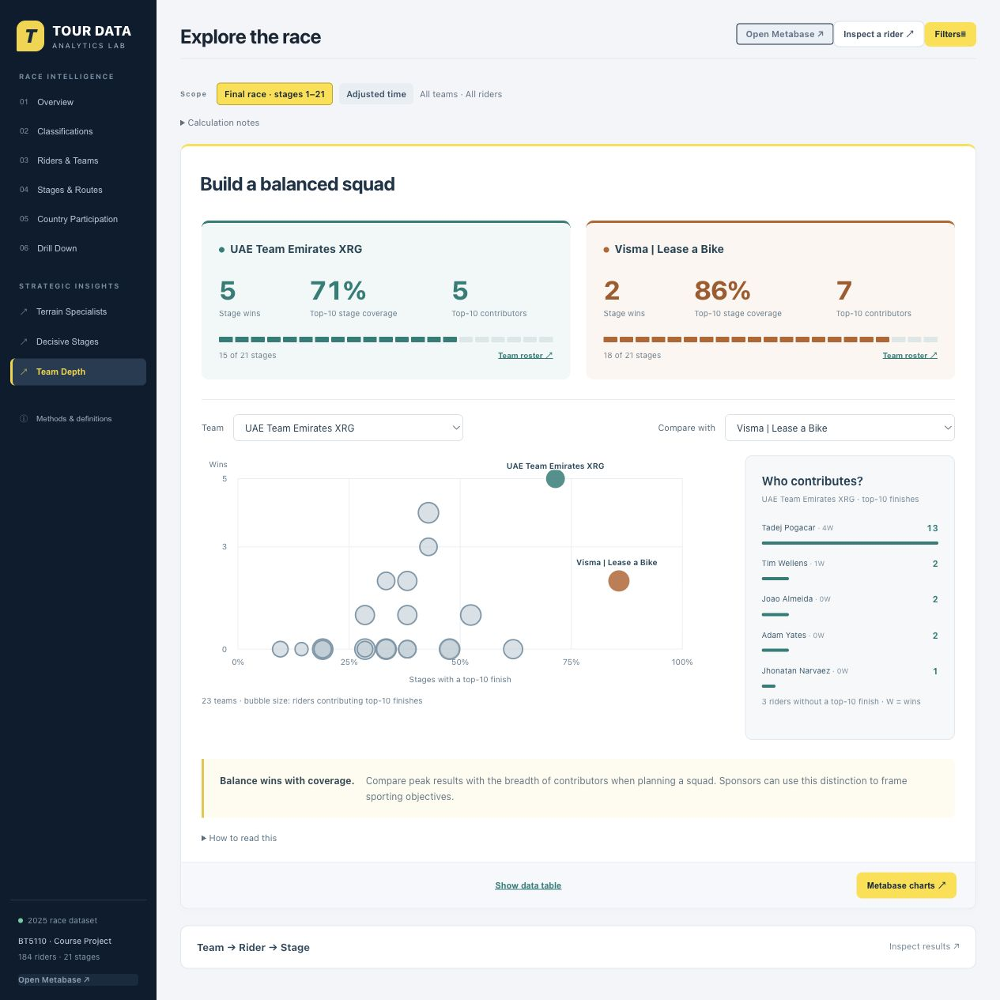

# Tour de France Analytics

A local analytics workspace for the supplied **2025 Tour de France course dataset**, built with **PostgreSQL, Metabase, FastAPI, and HTML/CSS/JavaScript**. It combines a normalized relational model, a dimensional warehouse, interactive dashboards, and reproducible query comparisons.



## Quick start

Install and start [Docker Desktop](https://docs.docker.com/get-started/get-docker/) on macOS or Windows, or Docker Engine with the Compose plugin on Linux. Windows must use **Linux containers**. Use a recent Compose version supporting `up --wait`; allocate at least **4 GB RAM** to Docker, preferably **6 GB**. The first launch needs internet access and may take several minutes. Host Python, Node.js, PostgreSQL, and Java are not required.

Download and extract the source ZIP, or clone this repository:

```bash
git clone https://github.com/CountofPenglai/tour-de-france-analytics.git
cd tour-de-france-analytics
```

Open a terminal in the folder containing `compose.yaml`.

**macOS / Linux**

```bash
bash start.sh
```

**Windows PowerShell**

```powershell
.\start.ps1
```

If your PowerShell policy blocks local scripts, review the script and run it for this process only:

```powershell
powershell -NoProfile -ExecutionPolicy Bypass -File .\start.ps1
```

The launcher builds the portal, generates installation-specific credentials, initializes PostgreSQL, imports the three CSV files, creates the Metabase questions and five-tab dashboard, enables signed embedding, and starts the web application. Subsequent launches retain existing data and credentials while reconciling the managed dashboard.

| Entry | Default URL | Access |
| --- | --- | --- |
| Dashboard | [http://127.0.0.1:8000](http://127.0.0.1:8000) | Opens directly; embedded analysis needs no separate login |
| Native Metabase | [http://127.0.0.1:3000](http://127.0.0.1:3000) | Log in, then open **Project 3 OLAP**; the portal also links to the generated dashboard |
| API reference | [http://127.0.0.1:8000/api/docs](http://127.0.0.1:8000/api/docs) | Interactive FastAPI documentation |

The generated Metabase email and password are in **`.runtime/admin-credentials.json`**. Keep this file private. Dashboard, card, and tab IDs are assigned by the new installation; no developer account or database dump is included.

## What the website provides

| Area | Main functions |
| --- | --- |
| Overview | Starters and finishers, winning margin, and the stage-finisher trend. Select a rider or stage for the supporting results. |
| Classifications | Compare GC, youth and mountain-time ranks in one row. Trace the selected rider’s largest daily change in GC position. |
| Riders & Teams | Compare roster depth, top-ten appearances and stage coverage. Follow the contributions to riders and individual days, then inspect team standings under either top-three rule. |
| Stages & Routes | Sort for the longest route, list time trials, or inspect a stage’s leading finishers and each team’s share of the top ten. |
| Country Participation | Compare registration and nationality counts, best final GC rank, wins, and podiums. Open the relevant roster or medal-winning results. |
| Drill Down | Choose Team, Stage Type or Country and a measure. Follow the hierarchy to the contributing results and return to the original comparison. |
| Exploratory Analysis | Compare stage-type speeds and mountain podiums in **Stage Type Fit**, follow cumulative time and reshuffles in **Decisive Stages**, and replay GC with or without bonuses and penalties in **Time Rules**. |

Filters support final-race, as-of-stage, and selected-stage scopes; stage type, team, rider, and young-rider selections; finish versus adjusted time; overall versus filtered-group ranks; and per-stage top-three versus cumulative top-three team methods. Applied filters remain available when navigating detail views. The native Metabase dashboard contains **33 displayed analytical cards plus one supporting question**, across five tabs.

### Reading the results

- The supplied CSVs contain **184 riders, 23 teams, 21 stages, 3,602 completed-stage results, and 24 exits**. There are **160 full-race finishers**. No missing results, nationality, team leaders, or awards are invented.
- Points Proxy and KOM Proxy are explicitly **derived proxies**, not official points or mountain classifications. They use the available stage-finish data.
- Tied ranks are retained. Unknown nationality is kept in performance/team analysis and excluded only when a nationality comparison needs a known country. Same-city route endpoints remain valid.
- Top-10 coverage is a sporting-visibility indicator, not measured media reach, sponsorship revenue, or return on investment.
- Race-context totals and country participation describe the full race. Stage summaries follow stage scope but cover all riders. The supplementary native Metabase Pivot is full-race; use the filterable Cross-Tab for a selected scope.

See [analytical definitions](docs/analytics.md), [data dictionary](docs/data_dictionary.md), and [source-grounded findings](docs/insights.md).

## Configuration

Before the first start, optionally copy `.env.example` to `.env` and edit its non-secret settings. The launcher creates `.env` automatically if it is absent.

```dotenv
COMPOSE_PROJECT_NAME=tdf-standard
PORTAL_PORT=8000
METABASE_PORT=3000
ADMIN_EMAIL=admin@tdf.local
```

If another application uses these ports, choose free values, for example `PORTAL_PORT=8001` and `METABASE_PORT=3001`. Run the launcher again after changing ports so embedded URLs and drill links are regenerated. `ADMIN_EMAIL` applies only when creating the installation; if you change its email or password through Metabase, update only the corresponding `email`/`password` fields in the private `.runtime/admin-credentials.json` before running initialization again. On macOS/Linux, the launcher also records `LOCAL_UID` and `LOCAL_GID` in `.env` so subsequent Compose tool commands retain access to private runtime files. Keep `COMPOSE_PROJECT_NAME` stable because it identifies the persistent database volume.

Services bind to **127.0.0.1**. PostgreSQL is reachable only inside the Docker network. This configuration is intended for a local course demonstration, not an internet-facing deployment. Metabase and the portal use a read-only database role; initialization uses separate owner credentials.

## Stop, restart, and preserve data

Run these commands from the same project folder:

```bash
# Stop without removing containers or data.
docker compose stop

# Resume a previously initialized installation.
docker compose up -d --wait

# Show service health.
docker compose ps

# Show recent diagnostic logs.
docker compose logs --tail=100 portal metabase postgres

# Remove containers and the network; retain the database volume.
docker compose down
```

For a source/configuration update, run `start.sh` or `start.ps1` again. The initializer preserves populated race tables and updates project-managed Metabase questions and dashboard layouts. Make separate copies of any manually customized questions you want to retain.

**Preserve both the PostgreSQL named volume and the private `.runtime/` directory.** The volume stores race data and Metabase application data; `.runtime/` stores credentials, the encryption/embedding keys, and object mappings. Do not delete `.runtime/` while keeping the volume, and do not use `docker compose down -v` for routine shutdown. Database dumps alone do not replace the encryption key. Keep backups private; they do not belong in a source release.

## Architecture and reproducibility

```text
Browser ──> FastAPI portal ──> PostgreSQL: tour_de_france
    └─────> Metabase ────────> PostgreSQL: tour_de_france (read-only)
                 └──────────> PostgreSQL: metabase_app

Three source CSVs ──> validated ETL ──> tdf (normalized) + dw (warehouse)
```

The warehouse has **two fact tables with distinct grains**—one result per rider per completed stage and one participation record per rider—and **five shared dimensions**. This prevents double-counting entrants when aggregating stage results. Eight core SQL functions and seven report functions supply the portal and Metabase with shared race calculations.

The standard package contains source code, CSVs, SQL, assets, and initialization scripts. It **does not contain Docker image layers, a live database, credentials, or local Git history**. The first build downloads official images and pinned Python dependencies; later operation uses the local images and volumes.

| Component | Pin / source |
| --- | --- |
| PostgreSQL | `18.6-bookworm`, official `postgres` image, immutable digest in `compose.yaml` |
| Metabase OSS | Verified `v0.65.2.5`, official `metabase/metabase:v0.65.2.x` image pinned by digest |
| Python | Official `python:3.12-slim-bookworm` image pinned by digest in `Dockerfile` |
| Python packages | Exact versions in `requirements.lock.txt`, installed from [PyPI](https://pypi.org/) |

Image indexes include **Linux ARM64 and AMD64** variants; no platform is hard-coded. Version pins are intentional and should be upgraded with testing. Source references: [Metabase on Docker](https://www.metabase.com/docs/latest/installation-and-operation/running-metabase-on-docker), [Metabase encryption](https://www.metabase.com/docs/latest/databases/encrypting-details-at-rest), and [Compose startup order](https://docs.docker.com/compose/how-tos/startup-order/).

## Verification and development

After startup:

```bash
# Offline Python tests inside the built image.
docker compose run --rm --no-deps portal python -m unittest discover -s tests -v

# Recheck database rules and execute every provisioned Metabase question.
docker compose run --rm --no-deps bootstrap python -m deploy.bootstrap --verify
```

Frontend regression checks require Node.js only for development (not deployment):

```bash
node --test tests/*.cjs
```

To reproduce the three normalized-versus-star SQL benchmark pairs without exposing a database password:

```bash
# /tmp is writable in the otherwise read-only portal container.
docker compose exec portal python scripts/benchmark.py --dsn-file /run/secrets/reader_database_url --output-dir /tmp/benchmark --repeats 7 --max-stage 21
mkdir -p build/benchmark
docker compose cp portal:/tmp/benchmark/. ./build/benchmark/
```

On PowerShell, create the destination with `New-Item -ItemType Directory -Force build/benchmark`. Results include exact-result equality checks and measured `EXPLAIN (ANALYZE, BUFFERS)` output. Timings depend on the host; see [benchmark methodology](docs/benchmark.md) and [package validation](docs/standard-package-verification.md).

## Project layout

```text
compose.yaml, Dockerfile     Container services and pinned application build
start.sh, start.ps1          First-start / update launchers
.env.example                Non-secret local configuration template
deploy/                     Credential generation and initialization
web/                        FastAPI application and static website
scripts/                    ETL, dashboard provisioning, benchmark, release export
sql/                        Relational/warehouse schemas, analytics, checks, benchmarks
data/                       Three supplied course CSVs
tests/                      Backend, frontend, and packaging regression checks
docs/                       Model, analytics, dashboard, and deployment references
.runtime/                   Generated private installation state; never commit
```

Further references: [star schema](docs/star-schema.md), [Metabase dashboard](docs/dashboard.md), and [portal/API reference](docs/portal.md).

## Troubleshooting

- **Docker is unavailable:** start Docker Desktop/Engine and confirm it uses Linux containers.
- **Port already in use:** change both settings as needed in `.env`, then rerun the launcher.
- **Metabase is still starting:** first launch can take several minutes. Check `docker compose ps` and the service logs; rerun the launcher after resolving a download or memory issue.
- **Authentication failure after changing the Metabase login:** synchronize the saved email/password in `.runtime/admin-credentials.json` with that account, then rerun the launcher. Do not rotate database or encryption keys.
- **Missing private files after a move:** restore the original `.runtime/` directory with the corresponding database volume. The initializer refuses to silently replace missing keys in an existing installation.
- **Blank or stale embedded view:** check Metabase health, rerun the launcher after port changes, and reload the browser. Use the native Metabase link or Explore while inspecting the issue.
- **Custom content changed after initialization:** the provided 34 questions and dashboard are managed by the provisioner. Keep personal copies in a separate collection.

## Preparing a GitHub repository

Use the exported source folder as the repository root. `.gitignore` excludes `.runtime/`, `.env`, virtual environments, generated output, and database backups. Review staged files before committing; never upload a live `.runtime/` directory or database dump.

`MANIFEST.sha256` records the exported files, and the ZIP has a separate SHA-256 checksum. To produce another clean source export with host Python 3.12:

```bash
python3 scripts/package_standard.py --output ../tour-de-france-analytics-new
```

An existing output is never overwritten. The exporter uses an allowlist and does not copy private runtime state or Git history.

## License and credits

Original project code and documentation are available under the [MIT License](LICENSE).

The hero photograph shows the **2024 Tour de France, Stage 13** (illustrative imagery; the analytical dataset remains 2025). Photo: **Hugo LUC**, [Wikimedia Commons](https://commons.wikimedia.org/wiki/File:Peloton_during_Simacourbe_climb_of_Tour_de_France_2024_stage_13.jpg), licensed under [CC BY-SA 4.0](https://creativecommons.org/licenses/by-sa/4.0/). The photo remains under that license, separate from the MIT-licensed code.

Supplied course data, photographs, trademarks, and dependencies retain their respective rights. See [third-party notices](THIRD_PARTY_NOTICES.md) for attribution and scope.
