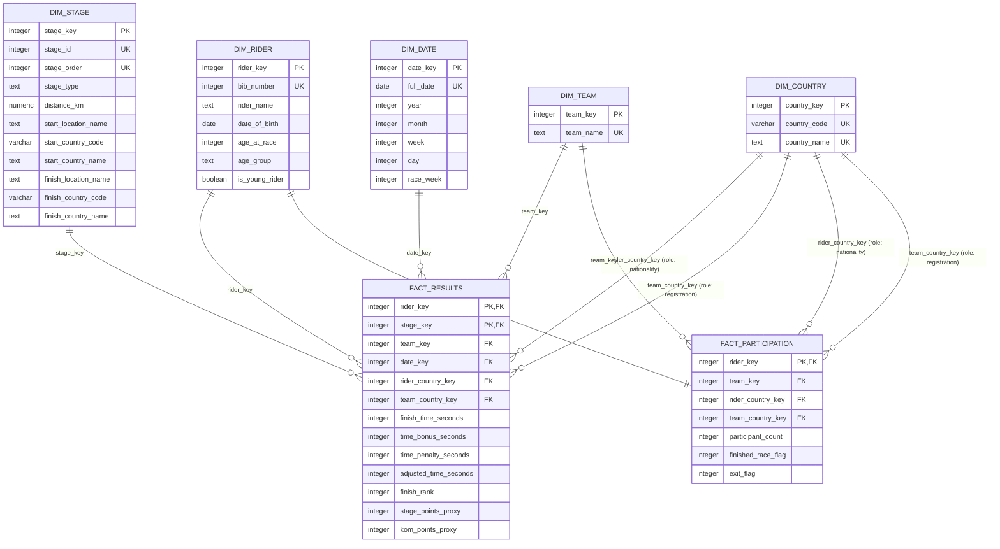

# Star Schema & Fact Constellation Design (`dw`)

## 1. Architecture Overview: Why Two Fact Tables (Fact Constellation)

The analytical warehouse (`dw` schema in [`sql/001_schema.sql`](../sql/001_schema.sql)) uses a **Fact Constellation (Galaxy Schema)** comprising **two star-schema fact tables** (`dw.fact_results` and `dw.fact_participation`) that share **conformed dimensions**:

1. **Primary Performance Star (`dw.fact_results`)**:
   - **Business Process**: Stage-by-stage race results and timing.
   - **Grain**: **One row per rider per completed stage** (`(rider_key, stage_key)`, `3,602` rows across `21` stages).
   - **Connected Dimensions (5)**: `dim_rider`, `dim_stage`, `dim_team`, `dim_date`, and `dim_country` (role-playing twice as `rider_country_key` and `team_country_key`).
2. **Participation Summary Star (`dw.fact_participation`)**:
   - **Business Process**: Rider entry, full-race completion, and withdrawal status for the 2025 Tour de France.
   - **Grain**: **One row per participating rider in the race** (`rider_key`, `184` rows: `160` finishers + `24` exits).
   - **Connected Dimensions (3)**: `dim_rider`, `dim_team`, and `dim_country` (role-playing twice as `rider_country_key` and `team_country_key`).

> [!IMPORTANT]
> **Why Separate Fact Tables Are Required (Grain Isolation)**:
> A rider who completes the Tour appears 21 times in `fact_results`, whereas a rider who withdraws early appears fewer times (and a rider exiting on Stage 1 has 0 stage-finish rows). Storing `participant_count` or `finished_race_flag` only on `fact_results` would either require expensive `COUNT(DISTINCT)` aggregations or lose riders with zero completed stages. Separating the two grains allows additive `SUM(participant_count)` and `SUM(finished_race_flag)` on `fact_participation`, while keeping `SUM(adjusted_time_seconds)` and `SUM(stage_points_proxy)` purely additive on `fact_results`.

---

## 2. Mermaid Entity-Relationship Diagram (Fact Constellation)

---

## 3. Core Data Warehousing Techniques Applied

### 3.1 Surrogate Keys & Natural Business Identifiers
Every dimension table uses an integer warehouse surrogate primary key (`rider_key`, `team_key`, `stage_key`, `date_key`, `country_key`) while preserving natural business identifiers (`bib_number`, `team_name`, `stage_id`, `full_date`, `country_code`) with `UNIQUE` constraints for lineage traceability back to `tdf`.

### 3.2 Conformed & Role-Playing Dimensions
- **Conformed Dimensions**: `dim_rider`, `dim_team`, and `dim_country` are shared identically between `fact_results` and `fact_participation`. Drill-across queries aggregate each fact table independently at the shared dimension grain (e.g., `team_key` or `country_key`) and join the aggregated results without row fan-out.
- **Role-Playing Dimension (`dim_country`)**: Both fact tables carry two foreign keys to `dim_country`:
  - `rider_country_key`: The rider's personal nationality (`country_key >= 0`).
  - `team_country_key`: The team's UCI registration country (`country_key > 0`).
  This enables side-by-side comparison of team registration countries vs. rider nationalities (e.g., `UAE TEAM EMIRATES XRG` is registered in `United Arab Emirates` with 0 Emirati riders, whereas `France` contributes 38 riders across multiple teams).

### 3.3 Unknown Member Handling (`country_key = 0`)
- In the raw `riders.csv` data, rider `#78 Aleksandr Vlasov` (`RED BULL - BORA - HANSGROHE`) has `'NULL'` nationality (`country_code IS NULL` in `tdf.rider`).
- In `dw.dim_country`, a dedicated unknown member row is pre-seeded:
  - `country_key = 0`, `country_code = 'UNK'`, `country_name = 'Unknown / Unspecified'`.
- Consequently, `rider_country_key` is strictly `NOT NULL` on both `fact_results` and `fact_participation`. Standard `INNER JOIN` queries in BI tools never drop `#78 Aleksandr Vlasov`'s 21 stage results (`285,524` adjusted seconds, GC rank 27) or his team contributions.
- Only rider nationality percentage charts explicitly filter `country_code <> 'UNK'` (using the 183 known-nationality riders as the denominator).

### 3.4 Dimension Denormalization & Solidified Derived Attributes
- **Route Denormalization in `dim_stage`**: In the normalized `tdf` schema, resolving stage start and finish countries requires joining `tdf.stage` to `tdf.location` twice on composite keys `(country_code, location_name)` and then to `tdf.country` twice. `dw.dim_stage` denormalizes `start_location_name`, `start_country_code`, `start_country_name`, `finish_location_name`, `finish_country_code`, and `finish_country_name` into a single dimension table.
- **Race-Anchored Rider Attributes in `dim_rider`**:
  - `age_at_race`: Computed deterministically as of Grand Départ (`2025-07-05`) so analytical cohorts never drift over time.
  - `age_group`: Categorized into `'U23'` (`<23`), `'23-25'`, `'26-29'`, and `'30+'`.
  - `is_young_rider`: `date_of_birth >= DATE '2000-01-01'` (Tour de France White Jersey eligibility).
- **Race Calendar Attributes in `dim_date`**: Includes `race_week` (`1`, `2`, `3`) to support roll-ups from individual dates/stages to Tour weeks.

### 3.5 Precomputed Additive Measures & Proxy Classifications in `fact_results`
To simplify OLAP aggregations and avoid repeating formulas across queries, ETL precomputes three additive measures on `fact_results`:

| Measure | Formula / Rule | Analytical Purpose |
| --- | --- | --- |
| `adjusted_time_seconds` | `finish_time_seconds - time_bonus_seconds + time_penalty_seconds` | Official time basis for GC, Young Rider, and Best Team classifications. |
| `stage_points_proxy` | Mapped by `(stage_type, finish_rank <= 15)`: • `flat`: `50, 30, 20, 18, 16, 14, 12, 10, 8, 7, 6, 5, 4, 3, 2` • `hilly`: `30, 25, 22, 19, 17, 15, 13, 11, 9, 7, 6, 5, 4, 3, 2` • `mountain` / `individual time-trial`: `20, 17, 15, 13, 11, 10, 9, 8, 7, 6, 5, 4, 3, 2, 1` | Transparent **Points Classification Proxy** derived purely from available stage finish data (since intermediate sprint results are not in the source CSV). |
| `kom_points_proxy` | Mapped by `(stage_type, finish_rank)`: • `mountain` (top 10): `20, 15, 12, 10, 8, 6, 4, 3, 2, 1` • `hilly` (top 5): `10, 6, 4, 2, 1` • Other stages: `0` | Transparent **KOM (Mountains) Classification Proxy** derived from climbing stage finishes (complemented by cumulative adjusted time on `mountain` stages). |
